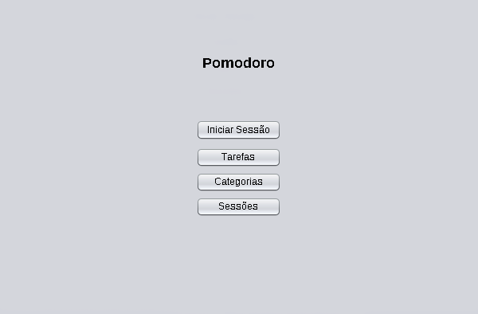
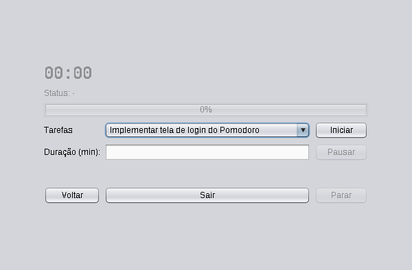
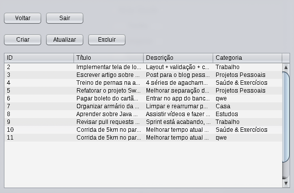
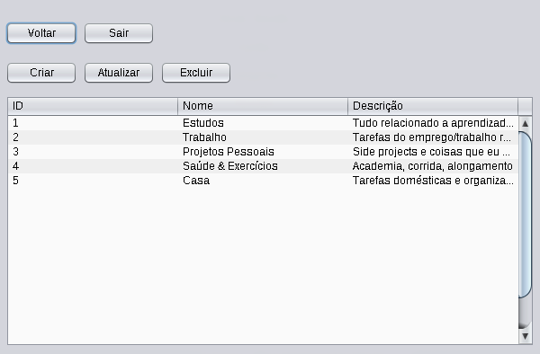
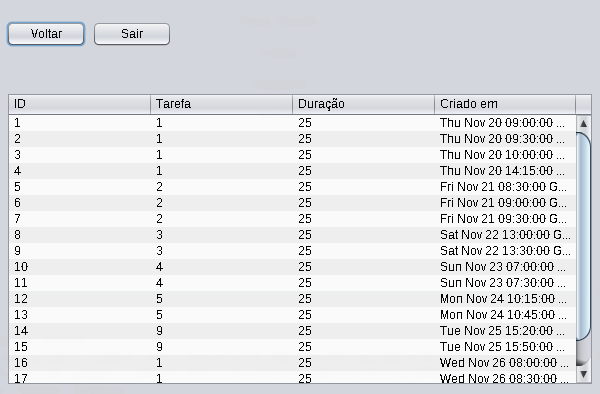

# Swing Pomodoro

Aplicação desktop para gerenciamento de tempo usando a técnica Pomodoro, construída inteiramente com Java Swing e sem dependências externas.

O projeto é organizado em camadas (model, service, DAO, controller, view), com persistência em arquivo texto e interface gráfica construída com o GUI Designer do NetBeans. As três entidades principais são categoria, tarefa e sessão Pomodoro, onde uma categoria agrupa várias tarefas e cada tarefa acumula suas sessões ao longo do tempo.

## Pré-requisitos

Java 8+ e NetBeans (necessário para editar o `.form` do Swing).

## Screenshots

<table>
  <tr>
    <td align="center">
      <b>Tela inicial</b> 
      
    </td>
    <td align="center">
      <b>Timer Pomodoro</b> 
      
    </td>
  </tr>
  <tr>
    <td align="center">
      <b>Tarefas</b> 
      
    </td>
    <td align="center">
      <b>Categorias</b> 
      
    </td>
  </tr>
  <tr>
    <td align="center" colspan="2">
      <b>Histórico de sessões</b> 
      
    </td>
  </tr>
</table>

## Autor

Gabriel Nathan — [devGabrielNathan](https://github.com/devGabrielNathan)
